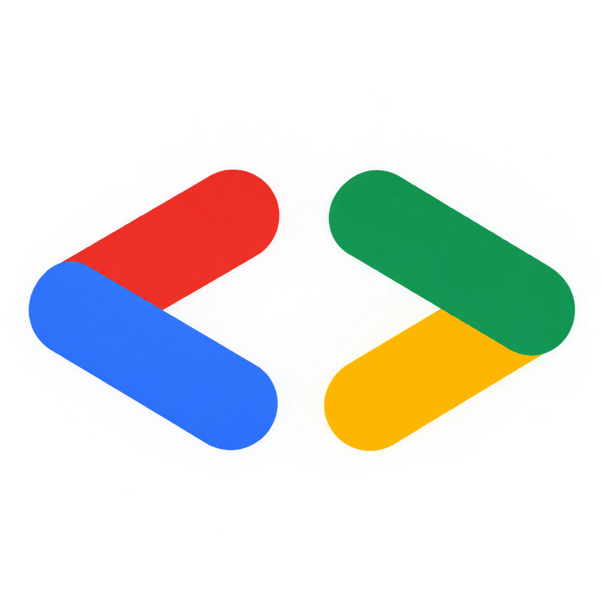

<p align="center">
  
</p>
<h1 align="center">Google Developer Groups on Campus</h1>
<h2 align="center">Manipal Academy of Higher Education, Dubai</h2>

<p align="center">
  <b>A student-led developer community bridging theory and industry through Google technologies.</b><br/>
  <i>Dubai International Academic City (DIAC) · United Arab Emirates</i>
</p>

<p align="center">
  
  
  
  
  
  
</p>

---

## 📖 Table of Contents

- [About the Chapter](#-about-the-chapter)
- [Technical Domains](#-technical-domains)
- [Flagship Programs & Events](#-flagship-programs--events)
- [Chapter Leadership & Roles](#-chapter-leadership--roles)
- [Getting Started & Contributing](#-getting-started--contributing)
- [Community Guidelines](#-community-guidelines)
- [Connect With Us](#-connect-with-us)

---

## 🏛️ About the Chapter

**Google Developer Groups (GDG) on Campus — MAHE Dubai** is a university-based developer community at **Manipal Academy of Higher Education, Dubai**.

Our goal is to foster a culture of hands-on technical exploration, continuous learning, and collaborative engineering. We provide a platform for students of all disciplines—from computer science to design and engineering—to connect, build real-world software, and solve pressing community problems using Google technologies.

```
     ┌───────────────────────────────────────────────────────────────┐
     │                   LEARN  •  CONNECT  •  GROW                  │
     │                                                               │
     │            Workshops ──► Hackathons ──► Solution Challenge    │
     └───────────────────────────────────────────────────────────────┘
```

### 🎯 Our Mission
1. **Bridge the Skills Gap**: Transition classroom theory into industry-ready software engineering practices.
2. **Community-Driven Impact**: Build technological solutions addressing the 17 UN Sustainable Development Goals.
3. **Peer-to-Peer Mentorship**: Encourage senior-to-junior knowledge transfer, code reviews, and project collaboration.
4. **Global Ecosystem Access**: Connect students with Google Developer Experts (GDEs), Google engineers, and regional tech leaders.

---
---

## 🚀 Technical Domains

GDG on Campus MAHE Dubai organizes activities across six dedicated engineering tracks:

```
┌────────────────────────────────────────────────────────────────────────┐
│                      GDG MAHE DUBAI TRACKS                             │
├─────────────────────┬──────────────────────┬───────────────────────────┤
│ 🤖 AI & ML          │ ☁️ Cloud & DevOps    │ 📱 Mobile Development.    |
│  • Gemini API / LLMs│  • Google Cloud (GCP)│  • Flutter & Dart         │
│  • TensorFlow & JAX │  • Firebase Backend  │  • Native Android / Kotlin│
│  • Autonomous Agents│  • Docker & K8s      │  • Multi-Platform Apps    │
├─────────────────────┼──────────────────────┼───────────────────────────┤
│ 🌐 Modern Web       │ 🔐 Systems & Security │  🏆 Open Source & DSA    │
│  • Angular / React  │                      │  • Git & GitHub Workflows │
│  • PWA & Web Vitals │  • Binary Analysis   │  • Solution Challenge     │
│  • TypeScript/Node  │  • Secur• Hackathon.             │
└─────────────────────┴──────────────────────┴───────────────────────────┘
```

---

## 🏆 Flagship Programs & Events

### 1. Google Solution Challenge
An annual global competition inviting university students to develop solutions for one or more of the **17 United Nations Sustainable Development Goals** using Google technology. We host idea-validation sessions, project sprints, and pitch practices.

### 2. Google Cloud Study Jams
Structured, instructor-led pathways covering cloud architecture, big data, and generative AI through Google Cloud Skills Boost labs, culminating in verifiable Google Cloud digital skill badges.

### 3. DevFest & Student Tech Summits
Annual flagship community gathering featuring keynote addresses, deep-dive technical workshops, hackathons, and product showcases.

### 4. Buildathons & Hands-On Code Labs
Intensive weekend build sessions focusing on shipping working prototypes, building agentic AI tools, and deploying production web/mobile apps.

---

## 👥 Chapter Leadership & Roles

Our chapter is organized into functional teams ensuring smooth operations and impactful learning:

* **Chapter Lead**: Drives vision, chapter direction, community growth, and liaison with Google.
* **Technical Leads**: Domain experts guiding curriculum in AI/ML, Cloud, Web, Mobile, and Systems.
* **Event & Operations Leads**: Coordinate logistics, venue management, and workshop scheduling.
* **Design & Branding Leads**: Maintain visual identity across social assets, slides, and websites.
* **Outreach & PR Leads**: Manage community communications, social media, and cross-campus collaborations.

---

## 🤝 Getting Started & Contributing

We welcome contributions from students, alumni, and developer enthusiasts across the UAE!

### Ways to Get Involved:
1. **Join the Community**: Register as an official member on the [GDG Community Platform](https://developers.google.com/community/gdg).
2. **Attend Workshops**: Participate in our weekly code-along labs and speaker sessions.
3. **Build Open Source**: Contribute to chapter repositories, starter templates, and community tools.
4. **Speak at Events**: Propose a lightning talk or workshop on a topic you are passionate about.
---
---

## 📜 Community Guidelines

GDG on Campus MAHE Dubai is dedicated to providing a harassment-free and inclusive community experience for everyone, regardless of gender identity, sexual orientation, disability, physical appearance, race, or religion.

* **Be Respectful**: Treat all community members with courtesy and kindness.
* **Be Collaborative**: Foster open discussion, encourage beginners, and share knowledge.
* **Be Constructive**: Give and receive feedback gracefully.

---

## 📬 Connect With Us

Stay connected with **GDG on Campus MAHE Dubai**:

* 🌐 **Community Platform**: [developers.google.com/community/gdg](https://developers.google.com/community/gdg)
* 🏫 **Campus**: Manipal Academy of Higher Education, Dubai International Academic City, UAE
* 💬 **Community Chat**: [Join our community Chat](https://chat.whatsapp.com/DgU17WVfGhbAtGdy6sSCzc)
* 💼 **LinkedIn**: [GDG on Campus MAHE Dubai](https://www.linkedin.com/company/gdgmahe/)
* 📸 **Instagram**: [gdgoc_mahedubai](https://www.instagram.com/gdgoc_mahedubai/)
* 🐙 **GitHub**: [github.com/gdg-mahe-dubai]
* 📨 **Email**: [email]gdgmahedubai@gmail.com
---

<p align="center">
  <b>Built with ❤️ by the GDG on Campus · MAHE Dubai Community</b><br/>
  <sub>© 2026 Google Developer Groups on Campus · MAHE Dubai. All rights reserved.</sub>
</p>
